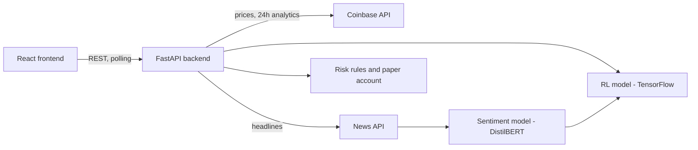
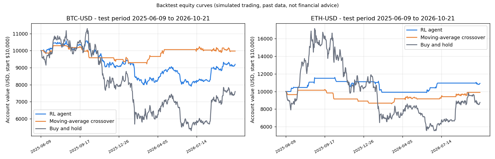

# AI Cryptocurrency Trading Assistant

A paper-trading app where a reinforcement-learning agent, news sentiment and risk rules decide when to buy and sell crypto, with every decision explained and every strategy backtested on real price history.

[](https://github.com/Rakshit-or-shadow/AI-Crytocurrency-Trading-Assistant/actions/workflows/ci.yml)
[](LICENSE)


> **Paper trading only.** All balances are simulated. No real orders are placed and no real money is used.


*(Demo GIF coming soon: `docs/demo.gif`.)*

## Features

- **Live prices** for 10 coins (Bitcoin, Ethereum, Solana, Ripple, Cardano, Dogecoin, Polygon, Litecoin, Polkadot, Bitcoin Cash) from the Coinbase API, with a 24-hour analytics panel.
- **Manual paper trading**: buy and sell with a simulated $250,000 balance, view holdings, reset the portfolio.
- **AI paper trader** you can start and stop from the website. It combines:
  - a TensorFlow reinforcement-learning model (LSTM-based deep Q-network, actions: hold / buy / sell),
  - a news sentiment score (NewsAPI headlines scored with a DistilBERT sentiment model; neutral if no key is set),
  - risk rules: fixed-percent position sizing, stop-loss, take-profit and a maximum exposure limit.
- **Explainable decisions**: every AI trade is saved with a plain-English reason (RL signal, sentiment score, final action, risk numbers). The "Why did the AI do this?" panel shows it, and buy/sell markers appear on the AI price chart.
- **Backtesting** of three strategies (RL agent, moving-average crossover, buy-and-hold) on real daily BTC and ETH data, with no lookahead. Results are shown on a Backtest page.
- **Tests and CI**: pytest tests for risk, balance logic, the moving-average strategy, backtest metrics and AI decision logic, run by GitHub Actions.

## Architecture



The frontend polls the backend every few seconds (no WebSockets).

## Tech stack

- **Frontend**: React 19, TypeScript, Vite, React Router, Recharts
- **Backend**: Python 3.12, FastAPI, Uvicorn
- **ML**: TensorFlow / tf-keras (reinforcement learning), Hugging Face Transformers + PyTorch (sentiment)
- **Data**: Coinbase API (prices), NewsAPI (headlines)
- **Tooling**: pytest, GitHub Actions, Docker, docker-compose

## Quick start

You need a Coinbase API key for live prices (see the table below). Without it the website loads but prices stay at 0. The backtest page and the tests work without any key.

### With Docker

```bash
cp backend/.env.example backend/.env   # then put your own keys in it
docker compose up --build
```

Website: http://localhost:3000, API docs: http://localhost:8000/docs

### Without Docker

Backend (Python 3.12):

```bash
cd backend
python -m venv venv
source venv/bin/activate          # Windows: venv\Scripts\activate
pip install -r requirements.txt   # use requirements-core.txt for a light install without TensorFlow
cp .env.example .env              # then put your own keys in it
cd app
python utils.py                   # API on http://localhost:8000
```

Frontend (Node 22):

```bash
cd frontend
cp .env.example .env
npm install
npm run dev                       # website on http://localhost:5173
```

### Run the tests

```bash
cd backend
python -m pytest tests
```

### Re-run the backtest

```bash
cd backend
python fetch_history.py   # optional: refresh the price CSVs from Coinbase (no key needed)
python backtest.py        # about 10 minutes on a CPU, mostly RL training
```

## Environment variables

| Variable | Where | Required | Purpose |
|---|---|---|---|
| `COINBASE_API_KEY` | backend | for live prices | Coinbase API key name |
| `COINBASE_API_SECRET` | backend | for live prices | Coinbase API private key |
| `NEWS_API_KEY` | backend | no | NewsAPI key; without it the sentiment score is 0 |
| `ALLOWED_ORIGINS` | backend | no | Comma-separated websites allowed to call the API (default `http://localhost:5173`) |
| `VITE_API_URL` | frontend | no | Backend address (default `http://localhost:8000`) |

## Backtest results

Real daily closes from Coinbase, 2024-01-26 to 2026-10-21 (1,000 days per coin). The RL agent trains on the first 500 days only; all strategies are scored on the last 500 days (2025-06-09 to 2026-10-21). Start balance $10,000, 0.1% fee per trade. Orders are filled at the next day's price.

| Coin | Strategy | Return | Sharpe | Max drawdown | Win rate | Trades |
|---|---|---|---|---|---|---|
| BTC-USD | RL agent | -8.0% | -0.33 | -25.2% | 38% | 24 |
| BTC-USD | Moving-average crossover | -0.2% | 0.02 | -10.4% | 33% | 12 |
| BTC-USD | Buy and hold | -24.0% | -0.28 | -53.1% | 0% | 1 |
| ETH-USD | RL agent | +9.2% | 0.60 | -14.8% | 50% | 12 |
| ETH-USD | Moving-average crossover | -1.0% | -0.02 | -15.8% | 50% | 12 |
| ETH-USD | Buy and hold | -12.4% | 0.16 | -67.6% | 0% | 1 |



How to read this honestly:

- The test window was a falling market, so buy-and-hold lost money. The RL and moving-average strategies keep much of their money in cash because of the risk rules, which is a big part of why they lost less. Buy-and-hold invests everything on day one, so the comparison is not like for like.
- The RL agent lost on BTC and gained on ETH. This is one random seed on one window, so it is not evidence of a real edge.
- Daily closes only: no slippage, no intraday moves, stop-loss checked on the daily close.

Full numbers and equity curves are in [`backtest_results.json`](backtest_results.json). More detail in [`docs/POLISH_NOTES.md`](docs/POLISH_NOTES.md).

## Project structure

```
.
├── backend/
│   ├── app/
│   │   ├── utils.py            FastAPI app: prices, paper portfolio, AI and backtest endpoints
│   │   └── src/
│   │       ├── ai_trader.py    AI paper trader (RL + sentiment + risk rules, explanations)
│   │       └── rl_model.py     Reinforcement-learning model and training
│   ├── risk.py                 Position sizing, stop-loss, take-profit, max exposure
│   ├── paper_account.py        Simulated balance and holdings (buy / sell logic)
│   ├── ma_crossover.py         Moving-average crossover baseline strategy
│   ├── backtest.py             Backtest engine, metrics, chart
│   ├── fetch_history.py        Downloads daily prices from Coinbase
│   ├── settings.py             Reads API keys from environment variables
│   ├── data/                   Daily BTC and ETH price CSVs
│   ├── models/                 Trained RL weights used by the live AI trader
│   └── tests/                  pytest tests
├── frontend/src/               React pages: coin page, AI chart, "Why" panel, backtest page, footer
├── docs/                       Backtest chart and project notes
├── backtest_results.json       Latest backtest output
├── docker-compose.yml
└── .github/workflows/ci.yml
```

## Roadmap

- Run the backtest over several random seeds and report the average and spread.
- More coins and longer price history in the backtest.
- Live updates over WebSockets instead of polling.
- Persist the AI trader's history in a database.
- Deploy a hosted demo.

## Disclaimer

This project is for education only and is **not financial advice**. It uses simulated money (paper trading) and never places real orders. Backtest results come from a short past period and do not predict future performance.

## License

[MIT](LICENSE) © Rakshit Singh
